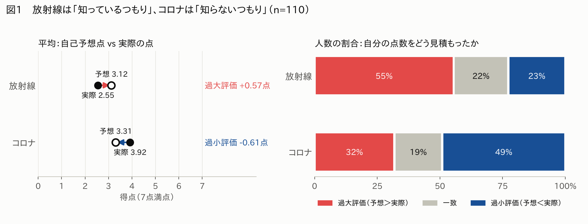
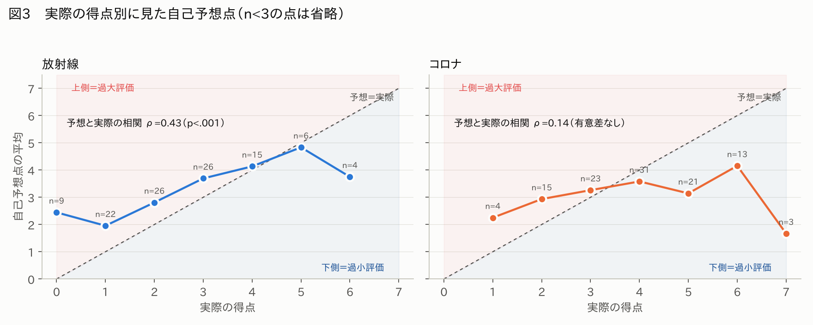
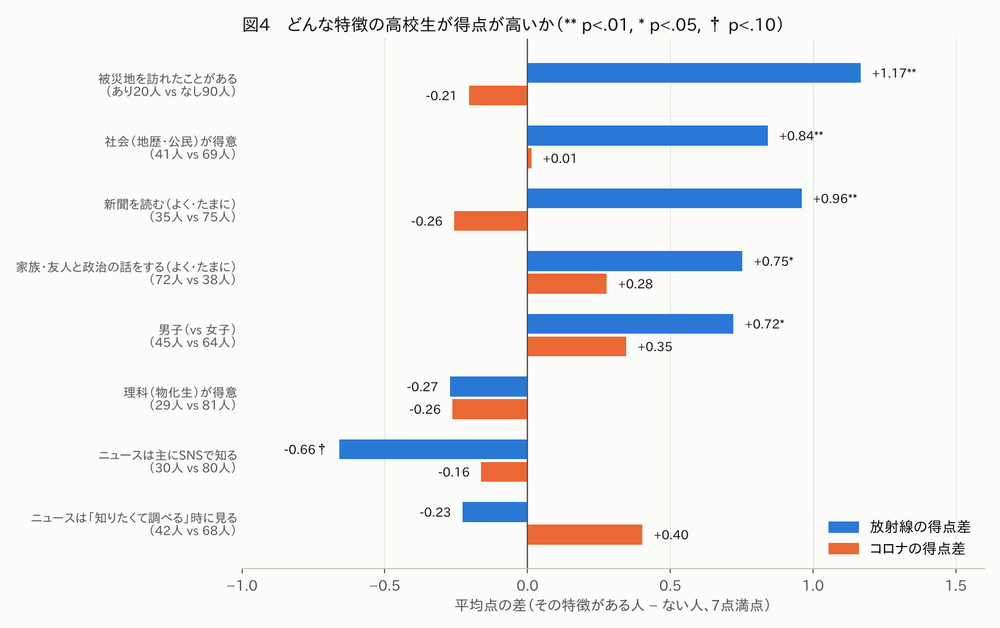
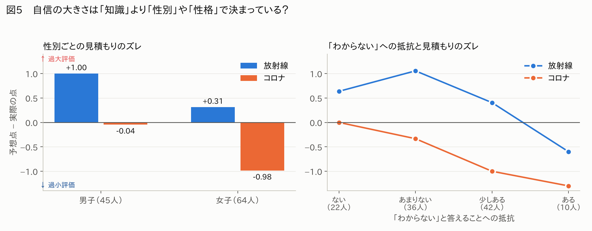
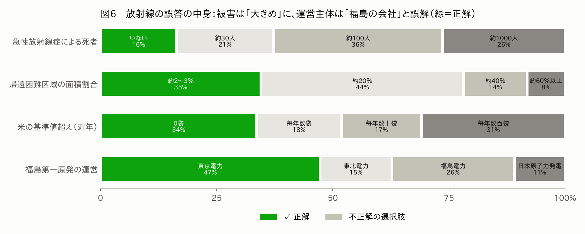
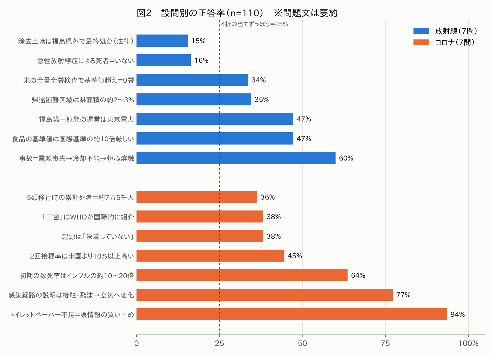

# 放射能・コロナアンケート 結果から言えそうなこと（分析・考察案）

- 対象: Googleフォーム「＜人々の放射能や新型コロナウイルスに対する考え＞に関するアンケート」
  - 回答スプレッドシート（`1tXl5CScjDfHkqglX--rky9zvtkIGvvPVwPW82LAb7KI`）、正誤判定済みスプレッドシート（`1nrlSTNmE_V5zBYhlUh6PL8kOq6y9N8YLF8sCCN4mxXU`）
- データ時点: 2026-11-03（回答 **110件**）
- 作成: Claude（研究アドバイザー役）。参照した資料は `docs/reference/04`・`06`・`10`（遠藤論文）・`24`（井上予稿）と研究計画書の仮説

---

## 0. 先に押さえておくべき前提（結果を読むときの注意）

| 項目 | 内容 | 意味すること |
|---|---|---|
| 地域 | **110件すべて東京都（創価高校）** | 福島データがまだ無いため、**「福島 vs 東京」の比較はまだできない**。以下はすべて「東京の高校生の中での違い」 |
| 学年 | 2年 84人（76%）・1年 13・3年 13 | 学年差の分析はほぼ無理 |
| 性別 | 女子 64・男子 45・無回答 1 | 女子がやや多い |
| 知識問題 | 放射線7問＋コロナ7問（各7点満点） | 正解キーはフォームの自動採点「スコア」と**110件すべてで一致**することを確認済み |
| 予想点 | 各ブロックの最後に「何問正解したと思うか」 | これを使うと「自信と正確さのギャップ（過信）」を測れる＝研究の核になる変数 |

> ⚠️ **正誤判定済みシートの手計算ミス**：「実際は何点？」（放射線）列に4件の誤りがありました（2026/10/17 の 11:49:32・12:46:11・13:45:52・14:18:39 の回答）。フォーム自動採点の値が正しいので、分析にはそちらを使ってください。メモにある数値（例: 予想3.1→実際2.6）は大きくは変わりません。

---

## 1. 言えそうなこと（強さ順）

### ★1　放射線は「知っているつもり」、コロナは「知らないつもり」（ズレの向きが逆）

- 放射線：予想 **3.12点** → 実際 **2.55点**（**過大評価**、p<.001）。55%の人が自分の点数を高く見積もった
- コロナ：予想 **3.31点** → 実際 **3.92点**（**過小評価**、p<.01）。49%の人が低く見積もった
- 実際の得点はコロナの方が明らかに高い（3.92 vs 2.55、p<.001）のに、**自信はほぼ同じ**

**考察の方向性**：研究計画書の「経験していない放射線と、経験したコロナで違いはあるのか」という問いに、**「経験していない放射線では知った気になり、経験したコロナでは逆に控えめになる」**という答えの候補が出てきた。なぜ逆になるのか（実体験があるから「自分はまだよく知らない」と感じる？／放射線は「よく聞く言葉」なので知った気になる？）は考察の大きな柱になる。

### ★2　放射線は「どれだけ知っているか」を自分でつかめているが、コロナはつかめていない

- 放射線：予想点と実際の点の相関 **ρ=0.43**（p<.001）→ 分かっている人は「分かっている」と自覚できている
- コロナ：相関 **ρ=0.14**（有意差なし）→ 高得点の人も低得点の人も予想点がほぼ同じ（3点前後）
- 両方とも「低得点者は高めに、高得点者は低めに見積もる」形になっている（いわゆるダニング＝クルーガー効果に似た形）
  - ※ただしこの形は統計的な「平均への回帰」でもある程度自然に出るので、**「効果」と言い切らない**方が安全

### ★3　放射線の知識は「人の特徴」で差がつくが、コロナの知識はほとんど差がつかない

放射線の得点が高かった人の特徴（単純比較）：

| 特徴 | 放射線の平均点の差 | 他の特徴の影響を除いた後（重回帰） |
|---|---|---|
| 被災地を訪れたことがある（20人） | **+1.17点**（p<.01） | **+1.03点**（p=.03）✅ |
| 社会（地歴・公民）が得意 | **+0.84点**（p<.01） | **+0.73点**（p=.02）✅ |
| 新聞を読む（よく・たまに） | **+0.96点**（p<.01） | +0.26（有意でない） |
| 家族・友人と政治の話をする | **+0.75点**（p<.05） | +0.15（有意でない） |
| 男子 | **+0.72点**（p<.05） | +0.45（有意でない） |
| ニュースは主にSNSで知る | −0.66点（p<.10） | **−0.62点**（p=.051）△ |
| 理科が得意 | −0.27（差なし） | — |

- **コロナの得点は、どの特徴ともはっきりした関係がない**（重回帰でも説明力 R²=0.09 とほぼゼロ）
- 放射線とコロナの得点同士の相関も **ρ=0.17（有意でない）** → 「物知りな人は両方得意」とは言えず、**2つの知識はほぼ別物**

**考察の方向性**：
- コロナは全員が実際に経験した出来事なので、**属性による差が「ならされた」**可能性がある。一方、放射線は経験していないぶん、**新聞・政治の会話・社会科の学び・被災地訪問など「本人の環境」で差が開く**
- 被災地訪問・社会得意は遠藤論文（`10`）と同じ結果で、**先行研究の再現**として書ける。一方で遠藤論文では「理科得意」もプラスだったが、本調査では関係なし → **相違点として考察に使える**
- ⚠️ ただしコロナの7問は問題同士の一貫性が低い（信頼性係数α=0.33、放射線はα=0.50）。「差がない」のは**問題のバラつきのせい**という可能性も、限界として書くべき

### ★4　自信の大きさは「知識」より「性別」で大きく違う

- 男子：放射線 予想3.96 / 実際2.96（**+1.00点の過大評価**）、コロナはほぼ正確（−0.04）
- 女子：放射線 予想2.55 / 実際2.23（+0.31）、コロナは予想2.78 / 実際3.77（**−0.98点の過小評価**）
- 実際の点数をそろえて比べても、**男子の予想点は女子より約1.1点高い**（p<.001、両分野とも）

**考察の方向性**：研究計画書では「過信の原因」として情報源（SNSなど）を想定していたが、データ上は**性別の方がずっと強い**。「SNSが過信を生む」という主張をするなら、**性別の影響を取り除いた上で**言わないといけない（男子の方がSNS利用時間が長い：6段階〔0=1時間未満〜5=5時間以上〕の平均 2.44 vs 1.77）。

### ★5　「わからない」と言うのに抵抗がある人ほど、自分の点数を**低く**見積もる（予想と逆？）

- 図5右：抵抗が「ある」人ほど予想点が低く、過信が小さい（放射線 ρ=−0.23、コロナ ρ=−0.24、どちらも p<.05）
- 性別・実際の点数をそろえても残る（予想点に対して約−0.4点／段階、p=.03）
- 解釈の候補：
  - (a) 「わからない」と言いたくない人＝**間違えることを気にする慎重な人**なので、点数も控えめに見積もる
  - (b) 質問文が「知らないことへの不安」と読まれた可能性（測定の問題）
- → 面白い「想定外の発見」候補。ただし「ある」は10人と少ないので、**インタビュー等で裏付け**が欲しい

### ★6　放射線の誤答は「被害を大きく見積もる」方向に集中している

- **急性放射線症による死者「いない」は16%のみ**。84%が「死者がいた」と回答（約100人 36%、約1000人 26%）
- 米の基準値超え・帰還困難区域・死者の3問で、**3問とも大きい方に間違えた人が42%**、3問全部正解は5%だけ
- 「除去土壌は県外で最終処分」（15%）・「急性放射線死者ゼロ」（16%）は**当てずっぽう（25%）より低い**正答率 → 単に「知らない」のではなく、**誤ったイメージを持っている**
- 一方、食品の基準値は「国際基準より厳しい」と答えた人が80%（約10倍 47%＋約100倍 33%）→ **「基準は厳しい」とは知っているのに「被害は大きい」と思っている**というねじれ

**考察の方向性**：風評被害の背景として「放射線の被害規模を実態より大きく思い込んでいる」ことが示唆される。講義資料（`03`）の風評被害・リスク認知の話と直結させやすい。
- ⚠️ 設問の作りとして、正解が「一番小さい選択肢」なので、間違えると必ず「過大」になる。「過大評価の傾向」と書くなら、この点を限界に書いておく

### ★7　「福島第一原発の運営＝東京電力」を知らない東京の高校生が半数

- 正答 **47%**。**実在しない「福島電力」を選んだ人が26%**、東北電力15%
- 被災地を訪れたことがある人は **80%** が正解、ない人は **40%**（p<.01）
- この問題は放射線の中で最も「知識の多い人／少ない人」を分ける問題（識別力が最大）
- 先行研究との比較：井上（`24`）では東京圏の正答率 **24.0%**、福島 53.3%。本調査（47%）は**東京としてはかなり高い**→ 創価高校の生徒が平均より関心が高い可能性（サンプルの偏り）。※井上は8択、本調査は4択なので、単純比較には注意
- **考察の方向性**：「福島の原発の電気は首都圏に送られていた」という構造（講義`02`の原子力村・地域と原発の話）を、**電気を使っていた側の東京の高校生が知らない**という「当事者性の欠如」として論じられる

### ★8　コロナ：「まだ決着していない」と言える人は、他のコロナ問題もよくできる

- 起源の問題で「決着していない」（正解）を選べたのは38%。45%は「自然界の動物由来である」と**断定**
- 「決着していない」を選んだ人は、**それ以外の6問でも平均が高い**（4.02 vs 3.24、p<.001）
- **考察の方向性**：「分からないことを分からないと判断できる力」が正しい知識と結びついている可能性。「デマ耐性」のテーマと相性が良い
  - ※この問題は男子の正答率が高い（51% vs 28%）ので、ここでも性別の影響に注意

### ★9　コロナ：日本の対策を「実際より低く」評価している

- 「三密」は「日本国内だけで使われた」が **47%**（正解の「WHOが国際的に紹介」は38%）
- 2回接種率は「アメリカより10%以上**低かった**」が **40%**（正解は「高かった」45%）
- 累計死者数は「多め（25万人・75万人）」が44%、「少なめ（7千人）」が20%
- トイレットペーパー不足＝誤情報による買い占めは **94%** が正解（ほぼ全員が知っている教訓）
- **考察の方向性**：コロナでは「被害は大きめに、日本の対策は小さめに」見積もる傾向。「日本は遅れていた」という当時の空気（記憶）と実際の結果にズレがある

---

## 2. 研究計画書の仮説はどうだったか

| 仮説 | 結果 | 判定 |
|---|---|---|
| **仮説1**：情報に能動的に関わる人ほど「正しく理解している」という自信が高い | 「知りたくて調べる」人（42人）と「暇つぶしで見る」人（62人）で、自己評価・予想点に差なし（例：放射線の予想 3.12 vs 3.20） | ❌ 支持されず |
| **仮説2**：SNSを主な情報源とする能動層は過信が大きい／報道・公的機関を確認する層は自信と正確さが一致 | 能動層の中で、SNS派（12人）の放射線の過信 +1.17点 vs それ以外 +0.53点。**方向は仮説どおり**だが人数が少なく有意でない（p=.30）。SNS派は放射線の得点自体が低め（p≒.05） | △ 傾向のみ。**人数を増やせば検証できるかも** |
| **仮説3**：被災地訪問など「経験を伴う能動性」がある層は過信が小さい | 被災地訪問者の放射線の過信 +0.05点 vs 未訪問 +0.69点。方向は仮説どおりだが有意でない（p=.19）。ただし**得点そのものは訪問者が明確に高い**（★3）。地域活動への参加は無関係 | △ 「過信」より「知識量」で効いている |

> 💡 開沼先生の10/30セッションのアドバイス「**当初想定していたものではない仮説をみつけて、それを論文に乗っける**」に沿うなら、★1（放射線とコロナでズレの向きが逆）、★4（性別）、★5（「わからない」への抵抗）、★6（被害の過大視）は、論文の「意外な発見」の候補になります。

---

## 3. 論文の「考察」に使えそうなストーリー案（例）

1. 高校生は、**経験していない放射線については「知った気」に、経験したコロナについては「知らない気」になっている**（★1・★2）
2. 放射線の知識は、**被災地訪問・社会科の学び**などの「環境」で差が開くが、コロナの知識は全員が経験したことで差がならされている（★3）
3. 放射線の誤解は「被害を大きく見積もる」方向に偏っており、これが風評被害の土台になっている可能性がある（★6・★7）
4. 自信と正確さのズレを生むのは、仮説で想定した「情報源（SNS）」よりも、**性別や「わからない」と言えるかどうか**といった個人の特性の方が大きい（★4・★5・★8）

---

## 4. 今後やっておくべきこと

1. **福島の高校のデータを入れる**（最優先）：研究の「福島で調査する必然性」（`06`）はここで示すことになる。福島データが入ると「被災地との距離」による差が分析できる
2. **10/31以降に個別に依頼した回答（11件）**は、それまでの回答より平均点が低い（5.27 vs 6.60点、p≒.05）。依頼の仕方でサンプルの性質が変わっている可能性があるので、**回答の集め方（クラス単位か個人依頼か）を記録**しておく（10/30メモの「声かけた人数は記録しておこう」と同じ）
3. 「SNS派」「被災地訪問者」は人数が少ない（12〜30人）ので、200件に増やしたときに再分析する
4. 検定を何十回も行っているので、偶然「有意」が出るものも含まれる。論文で主張するのは、**事前の仮説に関係するもの＋図1・図4のように差が大きいもの**に絞る
5. 正誤判定済みシートの手計算ミス4件を修正する（上記0章）

---

## 付録：分析の方法

- 得点：各問の正誤（フォームの自動採点と一致する正解キー）を合計。放射線・コロナ各0〜7点
- 過信（ギャップ）＝「何問正解したと思うか」−実際の得点
- 検定：2群の比較はマン・ホイットニーのU検定、3群以上はクラスカル・ウォリス検定、順序のある項目はスピアマンの順位相関（ρ）。重回帰は性別・新聞・テレビ・政治会話・社会得意・被災地訪問・SNS主情報源・接触動機・「わからない」抵抗・SNS時間・地域活動を同時に投入（頑健標準誤差 HC3）
- 有意水準の目安：p<.05 を「差がある」、p<.10 を「傾向」とした
