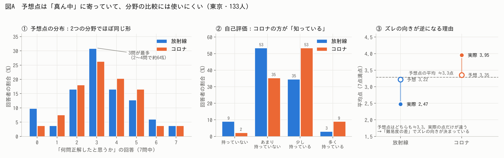
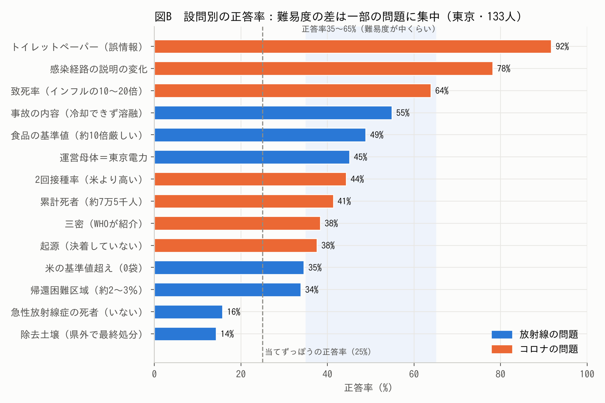
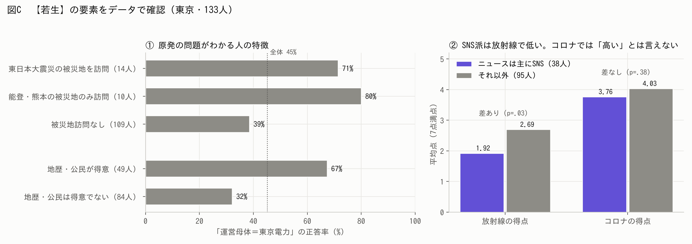

# 放射能・コロナアンケート 分析考察案【第2版】（11/9 追加分析）

- 対象: Googleフォーム「＜人々の放射能や新型コロナウイルスに対する考え＞に関するアンケート」
  - 回答スプレッドシート（`1tXl5CScjDfHkqglX--rky9zvtkIGvvPVwPW82LAb7KI`）
- データ時点: 2026-11-09 15:55（回答 **134件**。うち学年「保護者」の1件を除いた **高校生133人**で分析）
- きっかけ: 研究計画書の「11/9 pert2」の打ち合わせメモと、「考えられる要素」（今井メモ・【若生】）の追記
- 前の版: [`放射能・コロナアンケート_分析考察案.md`](放射能・コロナアンケート_分析考察案.md)（11/3時点・110件）。この第2版は、前の版の分析のうち**削除・修正すべきもの**と、**新しく言えそうなもの**をまとめたもの
- 作成: Claude（研究アドバイザー役）

---

## 0. 結論から

| | 内容 |
|---|---|
| 1 | 11/9メモの心配は当たっていた。「何問正解したと思うか」（予想点）はみんな**真ん中（2〜4問）**に答えていて、**放射線とコロナを比べる材料には使えない** |
| 2 | 代わりに「正しい知識をどれほど持っていると思うか」（**自己評価**）で見ると、**コロナの方が自信があるのに、その自信が実際の点数とほとんど結びついていない**という新しい話が出てくる |
| 3 | 【若生】の3つの要素のうち、「訪問」と「SNS→放射線が低い」はデータで支えられる。「勉強」はフォームに質問がないので直接は確かめられず、「SNS→コロナが高い」は支えられない |

### データの前提（前の版から変わらない点）

- **133人全員が東京都（創価高校）**。福島データはまだ無いので、「福島 vs 東京」の比較はまだできない
- 知識問題は放射線7問＋コロナ7問（各7点満点）。正解キーはフォームの自動採点と134件すべてで一致することを確認済み

---

## 1. 削除すべき分析

| # | 分析 | 判定 | 一言で |
|---|---|---|---|
| ① | 前の版★1「放射線は知った気、コロナは知らない気（経験の差）」 | ❌ 削除 | 予想点が真ん中に寄っているだけで説明できる |
| ② | 仮説2の検証「SNS派は過信が大きい」（予想点−実際点で測ったもの） | ❌ 削除 | SNS派は点が低いだけ。自己評価ではむしろ「知らない」と自覚 |
| ③ | 「コロナの点が高いのは経験したから」（【若生】の「（経験があるから）」も含む） | ❌ 削除 | 難易度の差で説明できる |
| ④ | 前の版★5「『わからない』に抵抗がある人ほど低く見積もる」 | ❌ 削除（付録へ） | 自己評価で見ると関係が消える |
| ⑤ | 今井メモ「高得点者は文化系が多い」 | ❌ 削除 | 他の特徴をそろえると差が消える／理由が説明できない |
| ⑥ | 今井メモ「14点は外れ値扱い」 | ⚠️ 理由を変えて確認 | 「点が高いから外す」はNG。ただし回答が不自然 |
| ⑦ | 前の版★3・★7の「被災地訪問」の定義 | 🔧 修正 | 東日本大震災と能登・熊本を分ける |

### ① 前の版★1「放射線は知った気、コロナは知らない気」→ 削除



```
          予想点の平均   実際の平均   ズレ
放射線       3.22          2.47      +0.74（多く見積もる）
コロナ       3.35          3.95      −0.60（少なく見積もる）
```

- 予想点は放射線とコロナで**ほぼ同じ**（差なし、p=.17）
- **2〜4問と答えた人が約64%**（放射線64%・コロナ65%）。**39%の人は両方に同じ数字**を書いている（図A①）
- 試しに「全員が3.3問と書いた」と仮定して計算しても、ズレは **+0.81／−0.67** になり、実際（+0.74／−0.60）とほぼ同じ
- → **ズレの向きは「気持ち」ではなく「問題の難しさの差」で決まっている**（図A③）。11/9メモの「ただ真ん中らへんの数を書いただけ」「難易度が響いている？」のとおり

### ② 仮説2「SNS派は過信が大きい」（予想点−実際点）→ 削除

| | SNSが主な情報源（38人） | それ以外（95人） |
|---|---|---|
| 予想点（放射線） | 3.18 | 3.23 |
| 実際の点（放射線） | **1.92** | **2.69**（p=.03） |
| 自己評価（放射線、0〜3） | **1.13** | **1.39**（p=.06） |

- SNS派の**予想点は他の人と同じ**。実際の点が低いだけ
- 自己評価で見ると、SNS派はむしろ「知らない」と答えている → **「知った気」ではなく「知らないことを自覚している」**
- ⚠️ **一般ルール**：「予想点−実際点」でグループを比べると、**点数が低いグループは自動的に「過信」に見えてしまう**（予想点がみんな同じくらいだから）。この方法での比較はすべてやめる

### ③ 「コロナの点が高いのは経験したから」→ 削除



- 事実確認（11/9メモ「平均点が同じだったかの確認」）：平均点は **放射線2.47 vs コロナ3.95で同じではない**（p<.001）
- ただし、**難易度が中くらいの問題（正答率35〜65%）だけで比べると、放射線49.6% vs コロナ45.1%で差がなくなる**（p=.54）
- コロナの高さは**簡単な2問**（トイレットペーパー92%・感染経路78%）、放射線の低さは**当てずっぽう（25%）以下の2問**（急性放射線症の死者16%・除去土壌14%）が原因
- → 11/9メモ「コロナの経験と問題の難易度は違う」のとおり。「経験したから点が高い」とは言えない

### ④ 前の版★5「『わからない』に抵抗がある人ほど低く見積もる」→ 削除（付録へ）

- 予想点とは関係がある（ρ=−0.21〜−0.29）
- しかし**自己評価で見ると、実際の点・性別をそろえると関係なし**（放射線 p=.17、コロナ p=.93）
- 測り方で結果が変わる＝弱い。本文からは外し、付録に回す

### ⑤ 今井メモ「高得点者は文化系が多い」→ 削除

- 単純比較では差がある（高得点者の60% vs 低得点者の41%が文化系、p=.04）
- しかし、性別・地歴公民得意・新聞・被災地訪問・SNSをそろえると、**放射線の点への影響はほぼゼロ（+0.07点、p=.81）**
- 「なぜ文化系だと詳しいのか」の理屈も説明できない
- ※同じく「**家族と政治の会話**」も、単純比較では差がある（「よく会話する」が高得点者30% vs 低得点者9%、p=.002）が、地歴公民得意・新聞をそろえると消える（p=.61）。削除まではしなくてよいが、**「関心が高い人のまとまり」の1つ**として扱うのが安全

### ⑥ 今井メモ「14点は外れ値扱い」→ 外す理由を変えて確認

- **「点数が高いから外す」はNG**（14点は正当な満点）
- ただしこの1件は、**満点なのに予想点が両方0問、自己評価も両方「あまり持っていない」**＝不自然。しかも**一番最初に送信された回答**（10/17 11:50）
- 同様に、**調査日（10/17）より前の10/6の回答**が1件ある
- → 2件とも**チームのテスト回答ではないか確認**し、テストなら除外する（下の「6. 要確認」参照）
- この2件を除いても、この文書の結論は変わらないことを確認済み

### ⑦ 「被災地訪問」の定義 → 修正

- 前の版では、能登・熊本の被災地に行った人も含めて「被災地訪問者」としていた
- 福島・原発の知識を見るときは、**東日本大震災の被災地（14人）と能登・熊本のみ（10人）を分けて**分析する（→ 2-④）

---

## 2. 新しく言えそうな分析

### ① 自信は「自己評価」で測る → コロナは「自信はあるが、実力と結びつかない」

11/9メモ「自信がありますか？という質問のほうで分析する」に対応。

- 「少し／多く持っている」と答えた人：**放射線38% / コロナ62%**。コロナの方が自信がある人は39%、逆は5%（p<.001）（図A②）
- 自己評価ごとの、実際の平均点：

```
自己評価        放射線         コロナ
持っていない     1.83          3.67（3人）
あまり           2.04          3.66
少し             3.11          4.06
多く             4.75（4人）    4.58
```

- **放射線**：自己評価が上がると点数もはっきり上がる（ρ=0.40）→ 自分がどれだけ知っているかを把握できている
- **コロナ**：自信があってもなくても点数がほぼ同じ（ρ=0.19）→ 「知っている」という感覚が正確な知識につながっていない
- **考察の方向性**：「経験したコロナでは"知っている"という感覚はあるが、それが正確な知識に結びついていない」。研究目的の**「自信と正確性のギャップ」に直接つながる新しい柱**になる
- ⚠️ コロナ7問は問題同士のまとまりが弱い（信頼性係数α=0.29、放射線はα=0.55）。「問題のせいで点数がブレているだけ」の可能性を**限界**に書く

### ② 性別：どちらの測り方でも男子の方が自信が高い（一番強い発見）

| | 男子（53人） | 女子（79人） |
|---|---|---|
| 自己評価（放射線、0〜3） | 1.55 | 1.16（p=.001） |
| 自己評価（コロナ、0〜3） | 1.91 | 1.56（p=.003） |
| 実際の点（放射線） | 2.92 | 2.15（p=.008） |
| 実際の点（コロナ） | 4.11 | 3.84（差なし） |

- **実際の点数をそろえても、男子は自己評価が約0.3段階高い**（放射線 p=.01、コロナ p=.004）
- 予想点でも同じ（点数をそろえて +0.85問、p=.001）
- 予想点・自己評価の**どちらで測っても出る＝測り方に左右されない**ので、論文の「意外な発見」として一番使いやすい

### ③ 放射線とコロナは「平均点」ではなく「相対的な位置」で比べる

11/9メモ「相対的な位置が分かればいい」に対応。

- 平均点は難易度で決まってしまうので、**各分野の中で「誰が上位にいるか」**を比べる
- 放射線で上位にいる人の特徴（他の特徴をそろえた上で）：

| 特徴 | 放射線の点への影響 |
|---|---|
| 地歴・公民が得意 | **+0.82点**（p=.002） |
| 被災地を訪れたことがある | **+0.82点**（p=.01） |
| 男子 | **+0.69点**（p=.02） |
| ニュースは主にSNSで知る | **−0.75点**（p=.005） |
| 新聞を読む（1段階ごと） | +0.27点（p=.08、傾向） |
| 家族・友人と政治の会話 | +0.09点（差なし） |
| 文化系の部活 | +0.07点（差なし） |

- コロナでは、**どの特徴でもほとんど差がつかない**（特徴で説明できる割合：放射線24% vs コロナ5%）
- → 「**放射線の知識は人の環境で差がつき、コロナの知識は差がつかない**」は、難易度に関係なく言える（ただしコロナはα=0.29なので①と同じ注意）

### ④ 【若生】の要素の検証



| 要素 | 結果 | 判定 |
|---|---|---|
| 〇〇原発かという質問（経営母体＝東京電力）が分かる人は、**実際に訪れたことがある人** | 東日本大震災の被災地を訪問 **71%** vs 訪問なし **39%**（p=.048） | ✅ ただし下の注意 |
| 〇〇原発かという質問が分かる人は、**勉強をしたことがある人** | フォームに学習経験の質問がない。代わりに「地歴・公民が得意」で見ると **67% vs 32%**（p<.001） | △ 言い換えが必要 |
| SNSで情報を得る層は、**放射線の正答率は低く**、**コロナの正答率は高い**（経験があるから） | 放射線 **1.92 vs 2.69**（p=.03、性別をそろえても−0.77点）／コロナ **3.76 vs 4.03**（差なし） | 前半✅ 後半❌ |

ここから新しく言えること：

- **能登・熊本の被災地にだけ行った人も80%が東京電力を正解** → 「福島に行ったから知った」より、「**被災地に足を運ぶほど関心がある人が知っている**」可能性（14人・10人と少ないので「可能性」止まり）
- 「東京電力」の正答率は、新聞・テレビ・地域活動・政治の会話も「よくする」ほど段階的に上がる。全部を同時に入れると、**地歴公民得意・新聞・男子・SNS以外**が残る
- **東京電力を正解した人は、他の6問も高い**（2.75 vs 1.42点、p<.001）
  - ※今井メモの「3.8 vs 1.5」は、この問題自体の1点を含んでいるので、**「他の6問」で比べる方が正確**
- **SNSの利用時間は点数と無関係**（放射線・コロナとも ρ≈0）→ 効いているのは「SNSをどれだけ使うか」ではなく、**「ニュースをSNSで知るかどうか」**

### ⑤ そのまま残してよいもの（前の版から）

- **★6** 放射線の誤答が「被害を大きく見積もる」方向に集中（死者「いない」16%、除去土壌14%＝当てずっぽう以下）
- **★7** 「福島第一原発の運営＝東京電力」を知らない東京の高校生が半数（上の④で補強）
- **今井メモ**：新聞を読む人が高得点（高得点者40% vs 低得点者23%、p=.04）／テレビは差なし（86% vs 80%）→ 再確認で同じ結果

---

## 3. 仮説の判定（自己評価版に更新）

| 仮説 | 結果 | 判定 |
|---|---|---|
| **仮説1**：情報に能動的に関わる人ほど「正しく理解している」という自信が高い | 「知りたくて調べる」人と「暇つぶしで見る」人で自己評価に差なし（放射線 1.33 vs 1.31） | ❌ |
| **仮説2**：SNSを主な情報源とする能動層は過信が大きい | SNS派は知識が低く、**自信も低い（自覚している）** | ❌（逆の結果） |
| **仮説3**：被災地訪問など「経験を伴う能動性」がある層は過信が小さい | 自己評価のズレに差なし。ただし**知識量は訪問者が高い** | △ |

> 💡 開沼先生の10/30セッション「**当初想定していたものではない仮説をみつけて、それを論文に乗っける**」に沿うなら、2-①（コロナは自信があるのに実力と結びつかない）、2-②（性別）、2-④（訪問先が福島でなくても正答率が高い）が「意外な発見」の候補。

---

## 4. 論文の「考察」に使えそうなストーリー案（第2版）

1. 高校生は、**経験したコロナについて「知っている」と感じている**が、その感覚は**実際の知識とほとんど結びついていない**。一方、放射線は自信も知識も低いが、**自分がどれだけ知っているかは把握できている**（2-①）
2. 放射線の知識は、**地歴・公民の学び、被災地訪問、ニュースの入手先**など「本人の環境」で差がつくが、コロナの知識は差がつかない（2-③）
3. 放射線の誤解は「被害を大きく見積もる」方向に偏っており、風評被害の土台になっている可能性がある（前の版★6・★7）
4. 自信の大きさを左右するのは、仮説で想定した「情報源」よりも**性別**の方が大きい（2-②）

---

## 5. 今後やっておくべきこと

1. **福島の高校のデータを入れる**（最優先）。入ったら、この文書の分析はすべてやり直す
2. **11/9メモの「この質問に◯%答えたグラフ」（単純集計）**を作る。フォームのPDFと並べて「どう聞いて、どう答えたか」を示す
3. 予想点（「何問正解したと思うか」）は、**分野どうしの比較には使わない**。使うなら「同じ分野の中で、誰が高く見積もるか」（例：性別）に限る
4. 「SNS派」「被災地訪問者」はまだ人数が少ない（10〜38人）ので、200件に増えたら再分析する
5. 検定を何十回もしているので、偶然「有意」が出るものも含まれる。論文で主張するのは、**仮説に関係するもの＋図A〜Cのように差が大きいもの**に絞る

---

## 6. 要確認（チームで確認してほしいこと）

- [ ] 【若生】の「〇〇原発かという質問」は、「**福島第一原発の経営母体（東京電力）**」の問題のことで合っているか（この文書ではそう解釈した）
- [ ] 【若生】の「**勉強をしたことがある人**」は何で測る想定だったか。東京のフォームには学習経験の質問がないため、この文書では「地歴・公民が得意」で代用した。**福島側のフォームには学習経験の質問があるか**
- [ ] **14点の回答**（10/17 11:50、予想点0・0）と**10/6の回答**は、チームのテスト回答か。テストなら除外する
- [ ] 学年「保護者」の回答（11/4 16:47）は、この文書では除外した

---

## 付録：分析の方法

- 得点：各問の正誤（フォームの自動採点と一致する正解キー）を合計。放射線・コロナ各0〜7点
- 自己評価：「正しい知識をどれほど持っていると思いますか」を 持っていない=0／あまり持っていない=1／少し持っている=2／多く持っている=3 として数値化
- 予想点のズレ＝「何問正解したと思うか」−実際の得点
- 難易度をそろえた比較：正答率35〜65%の問題（放射線3問・コロナ5問）だけで、1人ずつ正答率を出して比較
- 検定：2群の比較はマン・ホイットニーのU検定、対応のある比較（放射線 vs コロナ）はウィルコクソンの符号順位検定、割合の比較はフィッシャーの正確検定、順序のある項目はスピアマンの順位相関（ρ）
- 「他の特徴をそろえた上で」の分析：重回帰（頑健標準誤差 HC3）。放射線・コロナの得点に、性別・地歴公民得意・新聞・政治の会話・被災地訪問・SNS主情報源・文化系部活を同時に投入。自己評価は「実際の得点＋性別（＋『わからない』抵抗）」で回帰
- 東京電力の問題の分析：ロジスティック回帰（東日本の被災地訪問・地歴公民得意・新聞・政治の会話・性別・SNS主情報源）
- 有意水準の目安：p<.05 を「差がある」、p<.10 を「傾向」とした
- 図：東京・133人（テスト回答の可能性がある2件を含む。除外しても結論は同じ）
