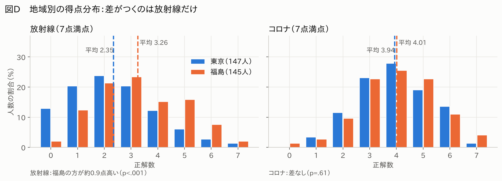
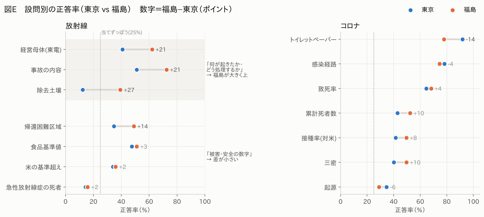
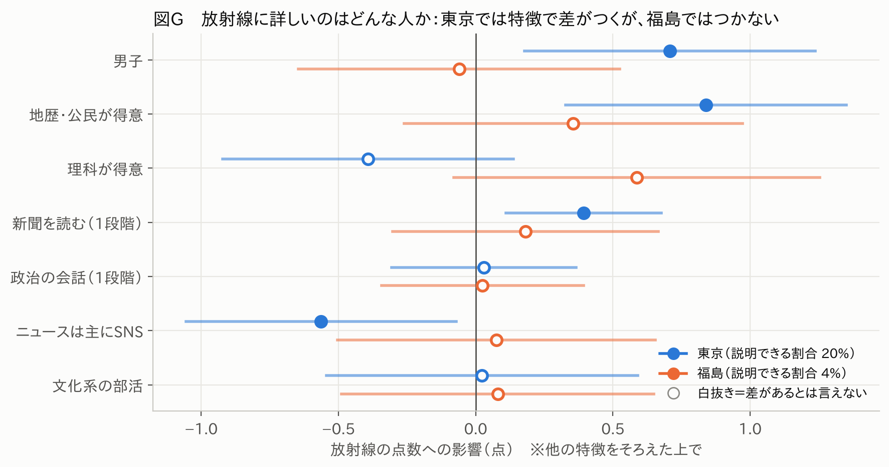
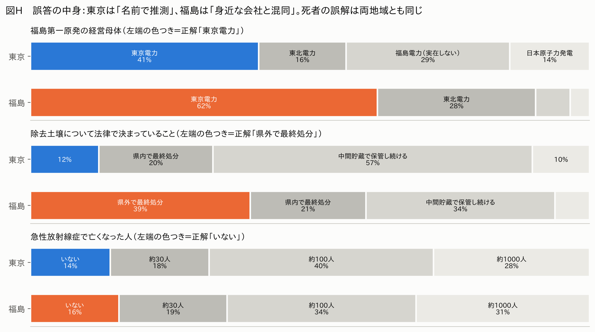
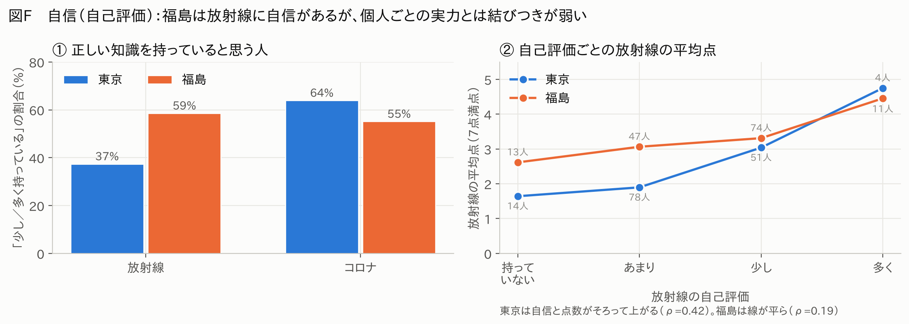

# 放射能・コロナアンケート 分析考察案【第3版】（11/14 福島データ追加）

- 対象: Googleフォーム「＜人々の放射能や新型コロナウイルスに対する考え＞に関するアンケート」
  - 回答スプレッドシート（`1tXl5CScjDfHkqglX--rky9zvtkIGvvPVwPW82LAb7KI`）。東京・福島とも同じシートに入っている
- データ時点: 2026-11-14 10:21（回答 **295件**）
  - 除外した3件：テスト回答と考えられる2件（10/17 11:50 の満点で予想0問の回答、10/6 の回答）と、学年「保護者」の1件（チームの判断どおり）
  - → **分析対象 292人（東京147人・福島145人）**
- きっかけ: 福島県の高校生のアンケート回答が集まったため（11/10〜11/14）
- 前の版: [第2版（11/9・東京のみ）](放射能・コロナアンケート_分析考察案_第2版_11-09.md)／[第1版（11/3・東京のみ）](放射能・コロナアンケート_分析考察案.md)。この第3版は、**福島×東京の比較で新しく言えること**と、**第2版の結論のうち東京だけにしか当てはまらなかったもの**をまとめたもの
- 作成: Claude（研究アドバイザー役）。参照した資料は `docs/reference/06`（福島で調査する必然性）・`10`（遠藤論文）・`24`（井上予稿）と研究計画書の仮説・11/9メモ

---

## 0. 結論から

| | 内容 |
|---|---|
| 1 | **放射線の知識は福島の方がはっきり高い（約0.9点、1年生どうしでは約1.3点）。コロナは差がない**。地域で差がつくのは放射線だけ |
| 2 | ただし福島が上回るのは「**何が起きたか・どう処理するか**」（経営母体・事故の内容・除去土壌）だけ。「**被害は小さかった・安全が確認されている**」ことを示す数字（急性放射線症の死者・米の検査・食品の基準）は、**福島の高校生も東京と同じくらい知らない**（急性放射線症の死者「いない」は福島でも16%） |
| 3 | 東京では「誰が放射線に詳しいか」が**性別・地歴公民・新聞・SNS**で決まっていたが、**福島ではどの特徴でも差がつかない**。しかも福島の生徒は東京で「詳しい人の条件」だった特徴（新聞・政治の会話）をむしろ持っていないのに、点数は高い |
| 4 | 福島の放射線への自信は**知識の高さに見合った分**だけ高い（過信ではない）。ただし**誰が自信を持っているかと、誰が実際に詳しいかの結びつきは東京より弱い** |
| 5 | 第2版で「一番強い発見」とした**「男子の方が自信が高い」は東京だけ**。福島では点数にも自信にも男女差がない |

### データの前提（読むときの注意）

| | 東京（創価高校） | 福島（1校） |
|---|---|---|
| 人数 | 147人 | 145人 |
| 学年 | 1年36・2年87・3年24 | **全員1年** |
| 性別 | 男子58・女子87（男子40%） | 男子84・女子60（**男子58%**） |
| 回答の集め方 | 10/17に授業で一斉＋その後に個別依頼 | **11/13朝に一斉（126人）**＋個別（19人） |
| 新聞を「たまに／よく読む」 | 31% | **8%** |
| 政治の会話を「たまに／よくする」 | 65% | **32%** |
| ニュースは主にSNS | 27% | **43%** |
| 東日本大震災の被災地を「訪れたことがある」 | 10% | **86%** |

- **福島は1校・1年生だけ、東京は1校・2年生中心**。なので「地域の差」には「学校の差」「学年の差」が混ざる。このため、**東京の1年生（36人）だけと比べる確認**も必ず行った（→ どの結論も変わらなかった）
- 福島の「訪問」は86%が「ある」。福島に住んでいる生徒が「住んでいる地域＝被災地」と考えて答えた可能性が高く、**福島では「被災地訪問」の変数として使えない**（遠藤論文のフォームには「居住している」という選択肢があったが、私たちのフォームにはない）
- 東京は第2版（133人）から新しい回答が16件増え、テスト回答と考えられる2件を除いたので147人になった。東京の数字は第2版と少し変わっている（結論は同じ）

---

## 1. 第2版から修正すべきもの

| # | 第2版の内容 | 福島データを入れた結果 | 判定 |
|---|---|---|---|
| ① | 2-②「性別：男子の方が自信が高い（一番強い発見）」 | **東京だけ**。福島では男女差なし | 🔧 「東京で見られた現象」に格下げ |
| ② | 2-③「放射線の知識は人の環境で差がつき、コロナはつかない」 | 東京では成立。**福島では放射線も差がつかない** | 🔧 新しい柱に作り直す（→ 2-③） |
| ③ | 2-④【若生】「SNSで情報を得る層は放射線の正答率が低い」 | **東京だけ**。福島ではSNS派も他の人と同じ点 | 🔧 「東京では」と限定する |
| ④ | 2-④「被災地に足を運ぶ人が東京電力を知っている」 | 東京では残る。**福島では「訪問」の意味が違うので比べられない** | ⚠️ 東京だけの分析として残す |
| ⑤ | 2-①「コロナは自信があるのに実力と結びつかない」 | **福島でも同じ**（結びつきはほぼゼロ） | ✅ 補強 |
| ⑥ | ★6「放射線の誤答は被害を大きく見積もる方向」 | **福島でも同じ**。地元でも被害を大きく思っている | ✅ 補強・**格上げ**（→ 2-②） |
| ⑦ | ★7「東京電力を知らない東京の高校生が半数」 | 福島62% vs 東京41%（**東京1年は22%**） | ✅ 補強（→ 2-④） |
| ⑧ | 予想点（何問正解したと思うか）は使わない | **地域の比較にも使わない**（下の注意） | 継続 |

### ① 性別の差は東京だけ

| | 東京 男子 | 東京 女子 | 福島 男子 | 福島 女子 |
|---|---|---|---|---|
| 放射線の点 | **2.74** | **2.08**（p=.01） | 3.27 | 3.22（差なし） |
| 自己評価（放射線、0〜3） | 1.52 | 1.18 | 1.55 | 1.62 |
| 点数をそろえた上での男子の自信の上乗せ（放射線） | **+0.23**（p=.03） | | −0.07（差なし） | |
| 点数をそろえた上での男子の自信の上乗せ（コロナ） | **+0.33**（p=.004） | | −0.04（差なし） | |

- 「男子は点数のわりに自信が高い」は**東京だけ**（地域によって違うことも検定で確認、p=.03〜.05）
- ⚠️ ただし東京でもこの差は**2・3年生で大きく**（自己評価 男1.58 vs 女1.18）、1年生では小さい（1.33 vs 1.20）。福島は全員1年生なので、**「地域の違い」なのか「学年の違い」なのかは区別できない**
- → 論文では「一番強い発見」から外し、「東京の上級生で見られた傾向」として扱うのが安全

### ⑧ 予想点を地域の比較に使わない理由

- 予想点−実際の点の「ズレ」は、東京 +0.88、福島 +0.43 で、福島の方が「控えめ」に見える
- しかし第2版で書いたとおり、**予想点はみんな真ん中（2〜4問）に答える**（東京65%・福島69〜73%）。すると**点数が高いグループは自動的に「控えめ」に見えてしまう**。福島は点数が高いので、このズレの差は意味がない
- → 自信の比較は、すべて**自己評価**（正しい知識をどれほど持っていると思うか）で行う

---

## 2. 新しく言えること（福島×東京）

### ① 地域で差がつくのは放射線だけ。コロナは差がない



| | 東京 | 東京1年だけ | 福島 | 差 |
|---|---|---|---|---|
| 放射線（7点満点） | 2.35 | 1.94 | **3.26** | **+0.91**（p<.001）、1年どうしで **+1.32** |
| コロナ（7点満点） | 3.94 | 3.92 | 4.01 | +0.07（差なし、p=.61） |

- 放射線の差は、**性別・得意教科・新聞・政治の会話・SNS・部活をそろえても残る**（+1.09点、p<.001）。学年もそろえると **+1.55点**
  - そろえると差が**大きくなる**のは、福島の生徒が「東京で点数が高かった人の特徴」（新聞・政治の会話など）をむしろ持っていないから（→ 2-③）
- コロナは、何をそろえても差が出ない（+0.23点、p=.22）
- 放射線とコロナの点数の相関は、両地域とも弱い（東京 ρ=0.15、福島 ρ=0.13）→ **2つの知識はほぼ別物**（第1版の結果を再確認）

**考察の方向性**
- 研究計画書の問い「経験していない放射線と、経験したコロナで違いはあるのか」に、地域の比較から答えられる：**コロナは日本中の高校生が同じように経験したので地域差がない。原発事故は福島の方が「近い出来事」なので、そのぶん知識に差がつく**
- 先行研究と同じ結果：遠藤論文（`10`）でも、知識・理解に**最も強く関係していたのは「福島県に住んでいること」**だった。井上予稿（`24`）でも総得点は福島4.12 vs 東京2.95で、本調査と同じ向き
- → `06`の指摘「**福島で調査する必然性**」に対して、「福島と比べることで初めて、**知識の差が『出来事との距離』で生まれていること、そしてその差が放射線にだけ出ること**が分かった」と答えられる

### ② 福島が上回るのは「何が起きたか」だけ。「安全を示す数字」は地元でも知られていない（一番の「意外な発見」候補）



放射線の7問を、問題の中身で2つに分けると、差のつき方がはっきり分かれる（この分け方はClaudeの提案。下の「要確認」参照）。

| グループ | 問題 | 東京 | 福島 | 差 | 1年どうしの差 |
|---|---|---|---|---|---|
| **A「何が起きたか・どう処理するか」** | 経営母体（東京電力） | 41% | 62% | **+21** | **+40** |
| | 事故の内容（冷却できず核燃料が溶けた） | 51% | 72% | **+21** | **+42** |
| | 除去土壌（県外で最終処分） | 12% | 39% | **+27** | **+31** |
| | **Aの平均** | **35%** | **58%** | **+23**（p<.001） | **+38**（p<.001） |
| **B「被害・安全の数字」** | 帰還困難区域（県の約2〜3%） | 35% | 49% | +14（p=.02） | +5（差なし） |
| | 食品の基準値（国際基準の約10倍厳しい） | 48% | 51% | +3 | +9（差なし） |
| | 米の基準超え（近年0袋） | 34% | 36% | +2 | 0 |
| | 急性放射線症の死者（いない） | 14% | 16% | +2 | +5（差なし） |
| | **Bの平均** | **33%** | **38%** | +5（p=.10、差とまでは言えない） | +5（差なし） |

- **A**では福島が大きく上回る。**B**ではほとんど差がない（「Aで差が大きく、Bで小さい」こと自体も検定で確認、p<.001）
- 福島の高校生でも、
  - **84%が「急性放射線症で亡くなった人がいる」**と答えた（約100人34%、約1000人31%）
  - **64%が「近年も基準値を超えた米がある」**と答えた
  - 米・帰還困難区域・死者の3問を**3問とも「大きい方」に間違えた人が36%**（東京45%）。3問とも正解は8%だけ

**考察の方向性**
- 福島の生徒は、**事故の経緯や除去土壌など「何が起きて、どう対応しているか」**はよく知っている。おそらく学校の震災学習や、中間貯蔵施設・除染などを身近に見聞きする生活から来ている
- 一方で、**「被害は思われているより小さい」「検査で安全が確かめられている」ことを示す数字**は、地元でも東京と同じくらい知られていない。
- → 風評被害の土台になる「被害の過大視」は、**被害を受けた側の地域の若い世代にも残っている**。これは「福島の人は詳しいはず」という予想を裏切る、**論文の一番の「意外な発見」候補**
- なぜBだけ差がつかないのか（**ここは仮説。データでは確かめていない**）：
  - (a)「米は0袋だった」「死者はいなかった」のような**安全側の情報は"ニュースになりにくい"**（何も起きなかったことは報道されにくい）
  - (b) 学校の震災学習の中身が「事故の経緯・復興の取り組み」中心で、**数字で安全を確かめる学習が少ない**
  - → 講義資料（`03`）の風評被害・リスク認知の話、開沼先生の「デマ」の話と結びつけて考察できる
- ⚠️ Bの問題の多くは**正解が一番小さい選択肢**なので、間違えると必ず「大きい方」になる。「過大評価の傾向」と書くときは、この点を限界に書く（第1版から同じ注意）

### ③ 東京では「個人の特徴」で知識に差がつくが、福島ではつかない



放射線の点への影響（他の特徴をそろえた上で）：

| 特徴 | 東京 | 福島 |
|---|---|---|
| 男子 | **+0.71点**（p=.009） | −0.06（差なし） |
| 地歴・公民が得意 | **+0.84点**（p=.001） | +0.36（差なし） |
| 新聞を読む（1段階ごと） | **+0.39点**（p=.007） | +0.18（差なし） |
| ニュースは主にSNS | **−0.56点**（p=.03） | +0.08（差なし） |
| 理科が得意 | −0.39（差なし） | +0.59（p=.08、傾向） |
| 政治の会話 | +0.03（差なし） | +0.02（差なし） |
| 文化系の部活 | +0.02（差なし） | +0.08（差なし） |
| **特徴で説明できる割合** | **20%** | **4%**（モデル全体でも差なし） |

- コロナは、**東京でも福島でも**特徴でほとんど差がつかない（説明できる割合 6〜7%）
- しかも福島の生徒は、東京で「詳しい人の条件」だった特徴を**あまり持っていない**（新聞を読む8% vs 31%、政治の会話32% vs 65%、SNSが主な情報源43% vs 27%）。**それでも放射線の点は福島の方が高い**
  - 例：福島のSNS派の平均3.25点は、**東京の非SNS派（2.52点）より高い**

**考察の方向性**
- 第2版の「放射線は人の環境で差がつき、コロナはつかない」は、福島を入れると次のように**言い直せる**：

```
                  放射線                        コロナ
東京   個人の特徴で差がつく（20%）      差がつかない（6%）
福島   差がつかない（4%）              差がつかない（7%）
         ↑                              ↑
   原発事故が「地域で共有された経験」   コロナは「全国で共有された経験」
```

- → 「**みんなが共有している経験・環境がある分野では、個人の関心や情報源の違いが知識の差になりにくい。共有されていない分野（東京にとっての放射線）では、本人の情報環境（新聞・SNS・得意教科）で差が開く**」
- これは研究の問い「**どのような特徴を持つ高校生が、正しい知識を多く持っているのか**」に対して、「**特徴が効くかどうか自体が、その出来事との距離で変わる**」という一段深い答えになる
- 三浦先生の「複数の変数を並べた時に『なぜかこの変数だけが突出して影響を与えている』という予想外の発見」にあたるのが、**「地域」という変数**
- ⚠️ 「要因の効き方が地域で違う」ことの検定は p=.07（傾向）。福島は1校・1年生なので、**同じ授業を受けた集団で差がつきにくいだけ**の可能性もある（限界に書く）

### ④ 東京電力・除去土壌：誤答の「中身」が地域で違う



**経営母体**
- 正答：東京41%（**1年生は22%**）・福島62%
- 間違え方が違う：
  - 東京：**実在しない「福島電力」が29%** → 名前（「福島」第一原発）からの推測
  - 福島：**「東北電力」が28%** → 自分の地域の電力会社との混同
- 井上予稿（`24`、8択）でも東京24.0%・福島53.3%で、同じ向き（本調査は4択なので数字そのものは比べられない）

**除去土壌**
- 「県外で最終処分」：東京**12%**（当てずっぽう25%より低い）・福島39%
- 東京の57%は「中間貯蔵施設で人体への影響がなくなるまで保管し続ける」を選んだ
- 井上予稿でも、除去土壌の最終処分を「知っていた」のは福島32.0%・東京15.2%で、同じ向き

**考察の方向性**
- 福島第一原発の電気は首都圏に送られていた（講義`02`）。除去土壌は**福島県外で最終処分すると法律で決まっていて、受け入れ先になりうるのは県外**。にもかかわらず、**電気を使っていた側・土を受け入れるかもしれない側の東京の高校生ほど知らない**
- → 「当事者性のずれ」：関係が深いのは東京側なのに、知識は福島側に偏っている

### ⑤ 自信：福島の自信は知識に見合っているが、個人単位では結びつきが弱い



| | 東京 | 福島 |
|---|---|---|
| 放射線の知識を「少し／多く持っている」 | 37% | **59%** |
| コロナの知識を「少し／多く持っている」 | **64%** | 55% |
| コロナの方が自信がある人／放射線の方が自信がある人 | **42% ／ 4%** | 17% ／ 18% |
| 自己評価と実際の点の結びつき（放射線） | **ρ=0.42** | ρ=0.19 |
| 自己評価と実際の点の結びつき（コロナ） | ρ=0.16 | ρ=0.01 |

- **福島は放射線に自信がある**。しかし**実際の点数・性別をそろえると、地域による自信の差は消える**（+0.12、p=.16）→ 福島の自信は**知識が高い分だけ高い＝過信ではない**
- 東京は「経験したコロナ」に自信が偏る（42% vs 4%）。**福島はコロナと放射線で自信が同じ** → 「経験した出来事には自信を持つ」という見方と合う（福島の生徒にとっては、どちらも身近な出来事）
- ただし、**福島では「誰が自信を持っているか」と「誰が実際に詳しいか」の結びつきが弱い**（ρ=0.19。東京の0.42より弱いことも検定で確認、p=.03）。図F②で、福島の線は平らに近い
- コロナは、**両地域とも**自信と実力がほとんど結びつかない（第2版2-①の補強）

**考察の方向性**
- 福島の生徒には、**「地元だから（なんとなく）知っている」という感覚が、個人の実際の知識とは別に広く共有されている**可能性がある
- 研究目的の「**自信と正確性のギャップ**」に対しては、「地域全体で見れば自信は知識に見合っているが、**一人ひとりで見ると、自分がどれだけ知っているかを把握できていない**」という形で答えられる
- これは2-②（福島でも安全の数字は知らない）とつながる：「知っているつもり」の中に「被害の過大視」が含まれていても、本人は気づきにくい

### ⑥ そのほか（論文に入れるかは任意）

- **コロナで唯一、地域差が出たのはトイレットペーパー**（誤情報による買い占め：東京92% vs 福島78%）。福島では「輸入が止まって実際に品不足になった」が16%。理由は分からないので、**本文には入れず付録扱い**を推奨
- 事故の内容で「**原子爆弾と同じ核爆発が起きた**」を選んだ人は福島14%（東京9%）。福島の方が正答率は高いが、この誤解は福島でも一定数ある
- 「『わからない』と言うのに抵抗がある」かどうかは、両地域とも点数・自信と関係なし（第2版で付録に回した判断のままでよい）
- 「知りたくて調べる」人と「暇つぶしで見る」人の差は、両地域ともなし（→ 仮説1）

---

## 3. 仮説の判定（福島データ込み）

| 仮説 | 東京 | 福島 | 判定 |
|---|---|---|---|
| **仮説1**：情報に能動的に関わる人ほど「正しく理解している」という自信が高い | 差なし（自己評価 1.33 vs 1.29） | 差なし（1.54 vs 1.58） | ❌ |
| **仮説2**：SNSを主な情報源とする能動層は過信が大きい | SNS派は知識が低く、**自信も低い（自覚している）** | SNS派も知識・自信とも他の人と同じ | ❌（東京では逆、福島では差なし） |
| **仮説3**：「経験を伴う能動性」がある層は過信が小さい | （訪問者は知識が高いが、過信の差はなし） | 個人の「訪問」は測れない。地域全体で見ると、**知識が高く、自信は知識に見合っている** | △（地域単位では支持。個人単位では検証できない） |

> 💡 開沼先生の「**当初想定していたものではない仮説をみつけて、それを論文に乗っける**」に沿うなら、**2-②（安全を示す数字は地元でも知られていない）**と**2-③（特徴が効くかどうかは出来事との距離で変わる）**が、福島データで初めて見えた「意外な発見」。

---

## 4. 論文の「考察」に使えそうなストーリー案（第3版）

1. 放射線の知識は福島の高校生の方が高いが、コロナの知識には地域差がない。**知識の差は「出来事との距離」で生まれ、全国で共有されたコロナでは生まれない**（2-①、遠藤・井上の再現）
2. ただし福島の優位は「何が起きたか・どう処理するか」に限られ、**「被害は小さかった・安全が確かめられている」ことを示す数字は、地元の高校生も東京と同じく知らない**。風評被害の土台である「被害の過大視」は、被災した地域の若い世代にも残っている（2-②）
3. 東京では、性別・地歴公民・新聞・SNSといった**個人の特徴**で放射線の知識に差がつくが、福島ではつかない。**共有された経験がある分野では個人差がならされ、共有されていない分野では本人の情報環境で差が開く**（2-③）
4. 福島の自信は知識に見合っているが、一人ひとりで見ると**自信と知識の結びつきは弱い**。「知っているつもり」と「被害の過大視」が同居しうる（2-⑤）
5. → **風評被害やデマへの対策は、「福島の外の人に事故のことを教える」だけでは足りない。地元も含めて、「安全を示す数字」を伝えることが必要**（研究目的「どのような要因を解決することで問題解決に至るのか」への答えの候補）

---

## 5. 限界（論文の「８．限界」に使える）

1. **福島は1校・1年生だけ、東京は1校・2年生中心**。「地域の差」に「学校・学年の差」が混ざる。東京1年生（36人）との比較でも同じ結果だったが、人数は少ない
2. **学習経験の質問がない**。遠藤・井上は震災学習の回数を測っていたが、本調査ではないので、福島の高さが「住んでいること」によるのか「学校の震災学習」によるのか区別できない
3. 「被災地訪問」の質問に「住んでいる」の選択肢がなく、福島では意味が変わってしまった
4. コロナ7問は問題同士のまとまりが弱い（信頼性係数 東京α=0.27・福島α=0.32。放射線は0.53・0.49）。「コロナでは何でも差がつかない」のは問題のブレのせいという可能性もある
5. 被害の数字の問題（死者・米・帰還困難区域）は正解が一番小さい選択肢なので、誤答は必ず「過大」になる
6. 回答の集め方で点数が少し変わる：福島の個別回答（19人）は授業内回答（126人）より放射線がやや高い（3.84 vs 3.17、p=.07）。東京でも第1版で同じ傾向があった
7. 検定を何十回も行っているので、偶然「有意」になったものも含まれうる。論文で主張するのは、**図D・E・Gのように差が大きく、1年どうしの比較でも残るもの**に絞る

---

## 6. 今後やっておくべきこと

1. ⚠️ **研究計画書「３．対象・範囲」の【確定文章】を書き直す**（最優先）。今の文章は**井上予稿（`24`）の本文がそのまま入っている**（「福島県内からは5校・1308名、東京圏からは2校545名…2025年1月14日〜」）。このままだと**他人の論文の丸写し**になるので、必ず自分たちの数字に置き換える。使える数字：
   - 東京都 創価高等学校：147名（1年36・2年87・3年24）、2026年10月17日〜11月14日
   - 福島県 ◯◯高等学校：145名（1年145）、2026年11月10日〜11月14日
   - 除外：テスト回答2件・保護者1件
2. 11/9メモの「**この質問に◯%答えたグラフ**」（単純集計）を、**東京・福島を並べて**作る
3. 2-②の「AとBの分け方」をチームで確認し、論文で使う名前を決める（下の「要確認」）
4. 2-②の仮説（「安全の情報はニュースになりにくい」「震災学習が経緯中心」）を確かめたいなら、**福島の協力校の先生に、震災学習でどんな内容を扱っているか**を聞く（インタビュー1回で考察の説得力がかなり上がる）
5. 追加でアンケートを取る場合（関西創価など）は、**「震災学習の回数」と「被災地に住んでいる」の選択肢を加える**

---

## 7. 要確認（チームで確認してほしいこと）

- [ ] 福島の**協力校名と学年・実施方法**（11/13朝に126人が一斉に回答しているので、授業内で実施したと解釈した）
- [ ] 2-②の分け方（A「何が起きたか・どう処理するか」＝経営母体・事故の内容・除去土壌／B「被害・安全の数字」＝帰還困難区域・食品基準値・米・死者）で良いか。特に**帰還困難区域をBに入れてよいか**（全体では福島が+14ポイント、1年どうしでは差なし）
- [ ] 福島の「被災地訪問」に「東日本大震災の被災地」と答えた86%は、住んでいる地域のことを答えたと解釈してよいか
- [ ] スプレッドシート上で編集済みの2件（「福島と間違えて回答→東京に修正」「1年と間違えて回答→2年に修正」）は、修正後の値で分析した

---

## 付録：分析の方法

- 得点：各問の正誤（フォームの自動採点と295件すべてで一致する正解キー）を合計。放射線・コロナ各0〜7点
- 自己評価：「正しい知識をどれほど持っていると思いますか」を 持っていない=0／あまり持っていない=1／少し持っている=2／多く持っている=3 として数値化
- 地域の比較：マン・ホイットニーのU検定、割合の比較はフィッシャーの正確検定、相関はスピアマンの順位相関（ρ）。相関の強さの地域差はフィッシャーのz変換で検定
- 「他の特徴をそろえた上で」の分析：重回帰（頑健標準誤差 HC3）。投入した特徴は、性別・地歴公民得意・理科得意・新聞・政治の会話・SNS主情報源・文化系部活（全体の分析では地域・学年も）。被災地訪問は福島で意味が変わるため、地域を比べる分析には入れなかった
- 要因の効き方が地域で違うかの検定：上の重回帰に「地域×各特徴」をまとめて加えたF検定（チャウ検定）
- 自己評価の地域差：「自己評価 ＝ 地域＋実際の点＋性別」の重回帰。男子の上乗せが地域で違うかは「地域×性別」を加えて検定
- AとBの差の検定：1人ずつ「Aの正答率−Bの正答率」を出し、地域で比較（重回帰、HC3）
- 1年生どうしの比較：東京の1年生36人と福島145人で同じ分析を行い、結論が変わらないことを確認
- 有意水準の目安：p<.05 を「差がある」、p<.10 を「傾向」とした
- 図D〜H：分析対象292人（東京147・福島145）
